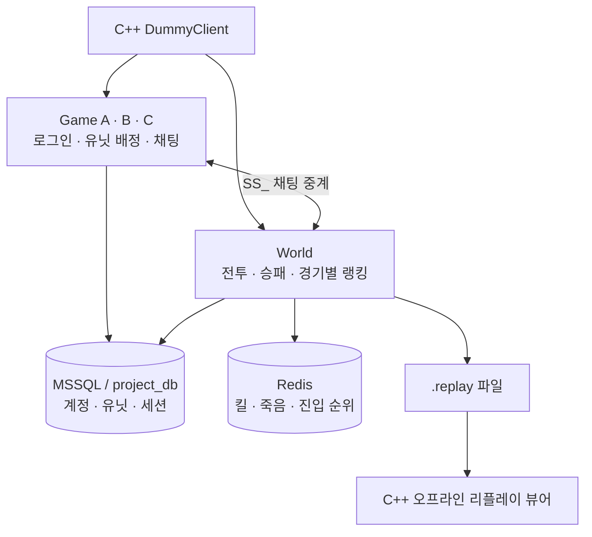
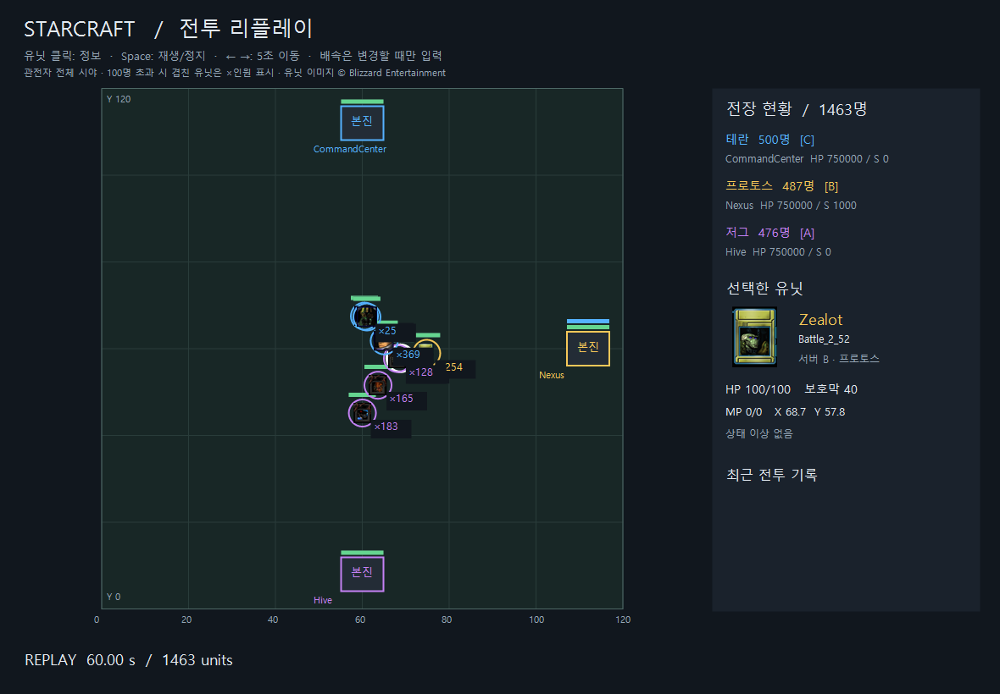
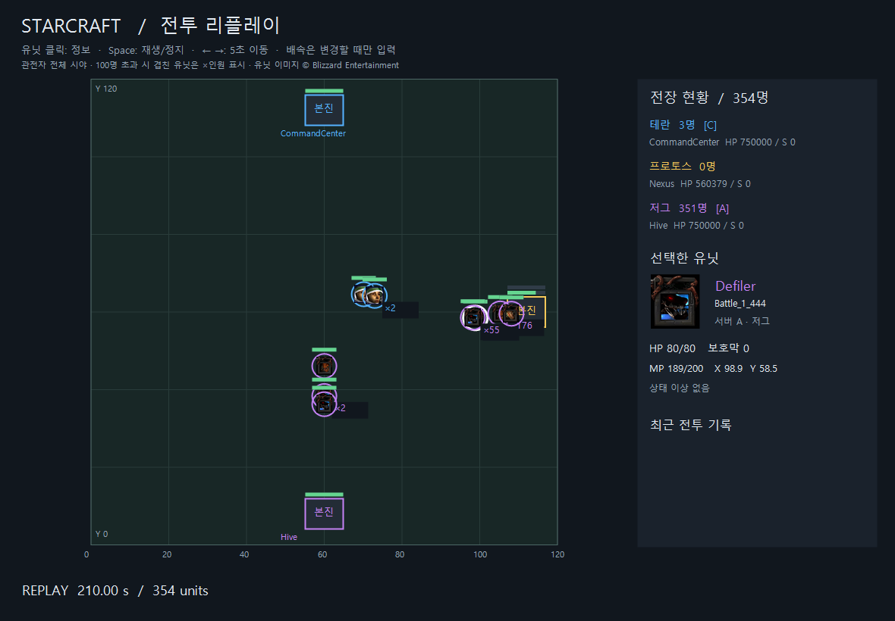

# StarCraft — IOCP 기반 멀티스레드 게임 서버

게임 서버 A·B·C와 공용 World 전장을 연결한 **C++20 서버 포트폴리오**입니다.
계정 로그인부터 서버 이동, 유닛 전투, Redis 랭킹, MSSQL 결과 저장과 오프라인 리플레이까지 구현했습니다.
C++ 더미 클라이언트로 기능과 부하를 검증하며, 언리얼 클라이언트 연동은 이후 범위입니다.

`C++20` · `Windows IOCP` · `Protobuf` · `MSSQL / ODBC` · `Redis / hiredis` · `Visual Studio 2019 / x64`

[구조와 쓰레드](#구조와-쓰레드) · [실행 화면](#실행-화면) · [빌드와 실행](#빌드와-실행) · [테스트](#테스트) · [측정 결과](#측정-결과) · [코드 읽기](#코드-읽기)

## 구현한 것

| 기능 | 내용 |
|---|---|
| 계정과 유닛 | ID·비밀번호 로그인, 첫 로그인 시 자동 등록, 고정 PlayerId와 서버별 랜덤 유닛 저장, 중복 로그인 차단 |
| 서버 이동 | 출발 Game 로그아웃 → 일회용 서명 입장권 발급 → World 로그인. 복귀도 입장권 검증 후 처리 |
| World 전투 | 이동, 건물 충돌, 유닛·건물 공격, 10종 스킬, 은신·탐지·장판, MP 회복 |
| 경기 규칙 | 사망·자발적 복귀 후 100초 재입장 대기, 본진 파괴 진영 퇴장, 마지막 본진 생존 진영 승리, 300초 후 재시작 |
| 채팅 | Game 서버 내부 일반 채팅, Game 서버 간 월드 채팅 중계, World 전장 내부 일반 채팅 |
| 랭킹과 정산 | Redis에서 경기별 킬·죽음·진입 순위 조회, 종료 결과는 MSSQL 저장, XML 결과 재적재 |
| 리플레이 | 전체 상태 + 변경분 + 행동 기록 저장, C++ 2D 뷰어의 재생·일시정지·배속·탐색·무결성 검사 |
| 비교와 검증 | IOCP / WSAPoll, 전투 계산 쓰레드 1·2·4, I/O 메모리 풀 ON/OFF, Linear / Grid 검색 비교 |

서버 목록·종족·포트는 [GameServer.csv](Data/GameServer.csv), 유닛·스킬·시작 좌표는 CSV, 쓰레드 수와 정원·틱은 [Server.ini](Server.ini)에서 관리합니다.
기본 서버는 A=저그, B=프로토스, C=테란이며 목록을 추가하거나 종족을 바꿀 수 있습니다.

## 구조와 쓰레드

Game A/B/C와 World는 **같은 실행 파일을 서로 다른 설정으로 실행한 별도 프로세스**입니다.
클라이언트는 이동권을 받아 목적지 서버에 새로 접속합니다.



**게임 상태는 게임 로직 쓰레드가 확정합니다.** 다른 쓰레드는 통신·독립 계산·저장을 맡습니다.

| 실행 주체 | 맡는 일 | 주요 코드 |
|---|---|---|
| IOCP 쓰레드(워커) | AcceptEx·WSARecv·WSASend 등록/완료 처리, 패킷 경계 확인, 게임 명령 등록 | `CIocpServer` |
| 게임 로직 쓰레드(메인) | 명령 처리, 틱 진행, HP·사망·킬·승패 확정 | `CGameLogic` |
| 전투 쓰레드(워커) | 이동·MP, 스톰 대상별 피해, 수신자별 시야 선택·직렬화 계산 | `CBattleWorkers` |
| DB 쓰레드(워커) | 계정·세션 처리, 종료 경기 저장, 완료 결과 반환 | `CDatabaseWorker` |
| Redis 쓰레드(워커) | 총계 갱신, 순위 조회, Redis 재연결 | `CRedisWorker` |
| 리플레이 기록 쓰레드(워커) | 기록 큐를 읽어 디스크 저장 | `Replay::CRecorder` |

전투 계산은 입력과 결과 배열을 먼저 만들고 각 쓰레드가 다른 결과 칸을 채웁니다.
메인은 완료를 기다린 뒤 결과를 순서대로 반영합니다. 전투 전체가 병렬 실행되는 구조는 아닙니다.
`Battle.WorkerCount=1`이면 같은 계산을 메인에서 수행합니다.

### 패킷 한 개가 처리되는 흐름

```text
WSARecv 수신 완료 → GQCS → HandleSessionCompletion
  → HandleClientPackets: TCP 바이트에서 완성된 패킷 분리
  → Submit: m_commands에 등록
  → Update → HandlePacket → HandleMove: Protobuf 해석·검증, 이동 목표 설정
  → Tick → MovePlayers: 이동 계산 분배 → 메인에서 결과 반영
  → BroadcastWorldState → SendPacket: 채널 sendQueue에 응답 적재
  → NotifySend → PostSend → WSASend → 송신 완료 처리
```

헤더는 **전체 길이 2바이트 + 종류 2바이트**, 본문은 Protobuf입니다. 전체 패킷은 4~4096바이트입니다.
패킷 종류는 [Packet.h](MultiThreadServer/MultiThreadServer/src/Packet.h), 필드는 [Game.proto](Protocol/Game.proto)에 있습니다.
`SYS_`는 시스템, `CM_`은 클라이언트→서버, `SM_`은 서버→클라이언트, `SS_`는 서버 간 통신입니다.

## 실행 화면

아래 이미지는 **실제 리플레이 파일을 현재 Release 뷰어의 화면 그리기 함수로 출력한 PNG**입니다.
2026-10-19의 1,500명 시연 기록을 2026-10-26 빌드로 재생했습니다. 새 부하 측정 결과는 아닙니다.
100명 초과 화면은 가까운 유닛을 묶어 표시하므로 `×N`은 표시 단위이며 피해 대상 제한이 아닙니다.

### 전투 진행 — 60초



### 전투 후반 — 210초



재생기는 서버·DB 없이 실행할 수 있습니다. 유닛 이미지는 Blizzard 자료를 식별 목적으로 사용하며 [출처](Assets/Replay/SOURCES.txt)를 별도로 남겼습니다.

## 빌드와 실행

### 1. 준비와 빌드

- Windows x64, Visual Studio 2019 C++ 도구(v142), Windows SDK 10.0.19041.0, CMake 구성 요소
- Windows PowerShell 5.1
- 로컬 SQL Server와 ODBC Driver 17 for SQL Server
- Redis 서버: 기본 `127.0.0.1:6379` (클라이언트 라이브러리만 빌드 스크립트가 준비)
- 최초 빌드는 Protobuf·hiredis 다운로드를 위한 인터넷 연결 필요

```powershell
git clone https://github.com/fnghd2012-git-project/StarCraft.git
cd StarCraft
powershell -NoProfile -ExecutionPolicy Bypass -File .\build.ps1 -Configuration Release -RunChecks
```

결과물은 `Run64/Release/`입니다. `-Configuration Debug`도 지원합니다.
의존성·Protobuf 생성 코드는 `.deps`, `Protocol/Generated`에 자동 준비하고, 실행 설정·CSV·시작 스크립트·이미지는 출력 폴더로 복사합니다.
솔루션은 `MultiThreadServer/MultiThreadServer/MultiThreadServer.sln`입니다.

### 2. 개인 DB 준비

SQL Server에서 개인 테스트용 `project_db`를 먼저 생성합니다. TCP 1433 접근과 현재 Windows 계정의 DB 권한이 필요합니다.

```powershell
.\init-database.ps1
.\Run64\Release\MultiThreadServer.exe --db-check
```

기본 연결은 `tcp:127.0.0.1,1433`, `project_db`, Windows 인증입니다.
다른 로컬 환경에서는 실행할 PowerShell의 환경 변수로 변경합니다.

```powershell
$env:MTS_DB_DRIVER = 'ODBC Driver 17 for SQL Server'
$env:MTS_DB_SERVER = 'tcp:127.0.0.1,1433'
$env:MTS_DB_NAME = 'project_db'
```

`init-database.ps1`은 안전하게 로컬 주소·Windows 인증으로 제한되어 있습니다.
입장권 서명키는 빌드 시 `Cluster.local.ini`로 로컬 생성하며 Git에 포함하지 않습니다.
DB 테이블은 [Database](Database), 연결 처리는 [Database.cpp](MultiThreadServer/MultiThreadServer/src/Database.cpp)를 참고하세요.

### 3. 서버와 더미 실행

`Run64/Release/StartServers.cmd`를 실행하면 Game A/B/C와 World **총 4개 서버**가 켜집니다.
서버를 켜 둔 상태에서 `StartDummy.cmd`를 실행하고 서버·계정 ID·비밀번호를 입력합니다.

| 위치 | 입력 예 | 동작 |
|---|---|---|
| Game | `status` | 배정 유닛과 계정 상태 |
| Game | `chat 일반 안녕하세요` | 같은 Game 서버에 채팅 |
| Game | `chat 월드 안녕하세요` | 다른 Game 서버에도 채팅 |
| Game | `world` | Game 로그아웃 후 World 로그인, 자동 전투 시작 |
| World | `auto off` | 자동 전투 중지 후 수동 조작 |
| World | `move 60 60` | 서버 판정 이동 |
| World | `skills` / `skill 1` | 스킬 목록 / 1번 슬롯 사용 (대상형은 ID·좌표 필요) |
| World | `rank kills` | Redis 킬 상위 10명과 내 순위 |
| World | `back` | 원래 Game 서버 복귀, 재입장 100초 대기 |
| 공통 | `quit` | 종료 |

리플레이는 기록을 마무리할 수 있도록 서버를 **Ctrl+C로 정상 종료**합니다.
네트워크 왕복만 확인하려면 서버 A를 켠 뒤 아래를 실행합니다. 이 검사는 완료 후 종료되는 것이 정상입니다.

```powershell
cd Run64\Release
.\DummyClient.exe --server A --clients 8 --rounds 20
```

### 4. 자동 경기와 리플레이

| 출력 폴더 실행 파일 | 확인할 내용 |
|---|---|
| `StartMatch10.cmd` | 서버당 10명, 건물 공략으로 한 경기 종료·복귀 검증 후 리플레이 |
| `StartBattle1500.cmd` | 서버당 500명, 유닛 전투·스킬·사망·재입장, 240초 시연 후 리플레이 |
| `StartReplay.cmd` | 저장된 `.replay` 선택, Play·Pause·배속·탐색 |

짧은 동작 점검은 출력 폴더에서 아래처럼 실행합니다. 이 경우에만 시연 사본의 재입장 대기를 3초로 줄입니다.

```powershell
cd Run64\Release
powershell -NoProfile -ExecutionPolicy Bypass -File .\StartBattle.ps1 -PerServer 10 -Seconds 30 -TestCooldownSeconds 3 -NoReplay
```

자동 시연은 별도 포트·DB Realm·설정 사본을 만들고 자신이 시작한 프로세스만 정리합니다.
반복 전투를 보기 위해 시연 사본의 본진 HP를 늘립니다. 수동 실행의 원본 데이터와 조건이 다릅니다.
리플레이 원본 파일은 용량 때문에 Git에 포함하지 않으며 위 실행기로 생성할 수 있습니다.

## Server.ini 주요 설정

설정을 바꾼 뒤 빌드하면 출력 폴더로 복사됩니다. 출력 폴더 파일을 직접 바꾸면 재빌드 시 덮어씁니다.
서버가 읽는 설정을 바꾼 뒤에는 재시작합니다.

| 항목 | 기본값 | 의미 |
|---|---|---|
| `[Network] Mode` | `IOCP` | `WSAPoll`로 비교 가능 |
| `[Network] WorkerCount` | `2` | 서버 프로세스별 네트워크 쓰레드(워커) 수 |
| `[Database] WorkerCount` | `2` | 서버 프로세스별 DB 쓰레드(워커) 수 |
| `[Battle] WorkerCount` | `4` | World 전투 계산 쓰레드(워커). `1`은 메인에서 계산 |
| `[Battle] TickRate` | `20` | 초당 20틱, 목표 간격 50ms |
| `[Battle] MaxWorldPlayers` | `1500` | World 동시 인원 상한 |
| `[Server.A/B/C] MaxPlayers` | `500` | 각 Game 서버 로그인 인원 상한 (각각 별도 섹션) |
| `[Memory] UsePool` | `1` | IOCP I/O 작업 객체·4096바이트 버퍼 재사용 |
| `[Memory] PoolCapacity` | `8192` | 풀 블록 상한 |
| `[Battle] SpatialSearch` | `Grid` | `Linear`와 같은 게임 규칙으로 검색 비교 |
| `[Replay] FrameTicks` | `1` | 매 틱 기록. `4`면 20Hz 기준 초당 5회 |
| `[Replay] SnapshotSeconds` | `1` | 전체 상태 스냅샷 간격 |
| `[Redis] Enabled` | `1` | World 랭킹 사용 여부 |

`VerifyParallel=1`, `VerifySpatialSearch=1`은 같은 입력의 결과 대조용입니다. 성능 측정 때는 `0`으로 둡니다.
메모리 풀은 Player나 모든 Protobuf 객체를 풀링하는 기능이 아닙니다.

## 테스트

프로젝트 루트에서 실행합니다. DB가 필요한 검사는 별도 Realm을 사용하지만 테스트 계정·결과가 개인 DB에 남습니다.

```powershell
.\test-network.ps1 -Configuration Release
.\test-network.ps1 -Configuration Release -NetworkMode WSAPoll
.\test-replay.ps1 -Configuration Release
.\test-parallel.ps1 -Configuration Release
.\test-ranking.ps1 -Configuration Release
```

| 테스트 | 검사 범위 |
|---|---|
| `test-network.ps1` | 동시 접속, TCP 분할·병합 수신, 최대 크기, 잘못된 패킷 |
| `test-gameplay.ps1` / `test-account-skills.ps1` | 로그인·이동·공격·스킬·사망·복귀·승패·재시작 |
| `test-parallel.ps1` | 전투 쓰레드 1·2·4와 직렬 계산 결과 대조 |
| `test-iocp.ps1` | 연결 중단·취소 완료 회수·풀 고갈·종료 수명 |
| `test-ranking.ps1` | 랭킹 일치, Redis 장애·복구, SQL 결과 재적재 중복 방지 |
| `test-replay.ps1` | 실제 상태 대조, 체크섬, 손상·잘림 검출 |
| `test-all.ps1` | 기본 기능 회귀를 순서대로 실행 |

IOCP·부하 비교 일부 실행기는 Python을 사용합니다. 현재 스크립트의 Python 경로와 로컬 Redis 실행 경로는 PC에 맞게 확인해야 합니다.
**이번 게시 점검(2026-10-26)**의 결과는 [검증 기록](docs/results/2026-10-26/readme/validation.md)에 정리합니다.

## 측정 결과

아래 수치는 **2026-10-19 측정 빌드의 기록**입니다. 이후 명명·구조 정리를 한 현재 코드의 새 성능 측정값이 아닙니다.

### 동일 부하에서 네트워크·전투 계산·풀 비교

96명, 네트워크/DB 쓰레드 2/2 고정, 5개 조건 × 3회입니다. 각 실행 지표 3개의 중앙값입니다.

| 조건 | 전투 응답 p95 (ms) | Snapshot 구간 p95 최대 (ms) |
|---|---:|---:|
| WSAPoll / 전투 1 | 32.208 | 4.093 |
| IOCP / 전투 1 / 풀 OFF | 16.485 | 4.259 |
| IOCP / 전투 1 / 풀 ON | 16.413 | 3.895 |
| IOCP / 전투 2 / 풀 ON | 16.576 | 2.981 |
| IOCP / 전투 4 / 풀 ON | 16.520 | 1.867 |

Snapshot 열은 실행 안의 **1초 구간별 p95 중 최대값**을 구하고, 이를 3회 중앙값으로 요약한 값입니다.
전체 표본 p95나 전체 서버 성능 개선 배수가 아닙니다. [요약 CSV](docs/results/2026-10-19/iocp/comparison.csv) · [실행별 CSV](docs/results/2026-10-19/iocp/comparison-raw.csv)

### 1,500명 전투 시연

| 항목 | 관측값 |
|---|---:|
| 준비 / 최대 동시 World | 1,500 / 1,500 |
| 사망 / 사망 후 재입장 | 2,668 / 2,138 |
| 연결·응답 오류 / 거부 응답 | 0 / 162,752 |
| 개별 Tick 최대 / 생략 틱 | 39.143ms / 0 |
| Redis·XML·MSSQL 점수 대조 | 1,500명 전 항목 일치 |

서버당 500명, 전원 준비 후 240초, 네트워크/DB 4/6, 전투 4, 20Hz, 기록 5Hz, 본진 HP 750,000 조건입니다.
시간 제한 후 `server_shutdown`으로 정상 종료한 **단일 PC 단회 시연**이며 승패 완료 경기·장시간 안정성·인터넷 수용량을 의미하지 않습니다.
거부 응답은 오류와 별도이며 상세 사유별 수량은 분류하지 않았습니다. [원본 검증 요약](docs/results/2026-10-19/iocp/stress-validation.json)

## 코드 읽기

서버 소스의 기준 경로는 `MultiThreadServer/MultiThreadServer/src/`입니다.

| 순서 | 파일·함수 | 읽을 내용 |
|---|---|---|
| 1 | `TcpServer.cpp`: `RunTcpServer` | 게임 로직·네트워크 객체 생성과 수명 |
| 2 | `IocpServer.cpp`: `Run`, `HandleSessionCompletion` | GQCS 완료 처리와 세션 잠금 |
| 3 | `PacketDispatch.cpp`: `HandleClientPackets` | TCP 버퍼에서 패킷 분리·명령 등록 |
| 4 | `GameLogic.cpp`: `Submit`, `Update`, `HandlePacket` | 명령 큐와 게임 상태 소유권 |
| 5 | `GameBattle.cpp`: `MovePlayers` / `BattleWorkers.cpp`: `Run`, `Work` | 계산 분배·완료 대기·메인 반영 |
| 6 | `GameLogic.cpp`: `SendPacket` / `IocpServer.cpp`: `PostSend` | 응답 큐·버퍼 수명·부분 송신 |
| 7 | `GamePersistence.cpp`, `DatabaseWorker.cpp`, `RedisWorker.cpp` | 비동기 저장과 결과 반영 |
| 8 | `GameReplay.cpp`, `Replay.cpp`, `DummyClient/src/ReplayWindow.cpp` | 상태 수집·기록·복원·화면 표시 |

| 폴더 | 내용 |
|---|---|
| `MultiThreadServer/` | 서버 솔루션과 소스 |
| `DummyClient/` | 수동 클라이언트, 자동 전투·부하·리플레이 뷰어 |
| `Protocol/` | Protobuf 원본과 패킷 계약 |
| `Data/` / `Database/` | 게임 데이터와 SQL 스키마 |
| `Launch/` | 서버·더미·시연 시작 스크립트 |
| `docs/` | 설계, 컨벤션, 검증 기록, 학습 문서 생성 소스 |

[게임 설계](docs/Design.md) · [코드 컨벤션](docs/CodeConventions.md) · [개발 과정·과거 측정](docs/DevelopmentHistory.md)

## 현재 범위와 한계

언리얼 클라이언트, 유닛 간 물리 충돌·일반 길찾기, 맵별 동적 쓰레드 배정, TLS, 진행 중 World 전체의 강제 종료 복구는 구현하지 않았습니다.
현재 랭킹은 단일 World·단일 Redis 기준입니다. 저장 큐·디스크 오류 시 결과 유실 가능성을 로그로 알리며, Redis 복구는 살아 있는 World 메모리의 경기 총계를 다시 반영하는 방식입니다.

빌드 결과·의존성·로컬 키·리플레이 원본·생성 PDF·임시 편집 사본은 Git에서 제외합니다.
게임 이미지 출처는 [Assets/Replay/SOURCES.txt](Assets/Replay/SOURCES.txt), hiredis 고지는 [ThirdPartyNotices.txt](ThirdPartyNotices.txt)를 참고하세요.
