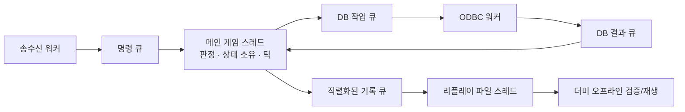

# 게임 서버 설계와 데이터

## 목표와 구현 경계

스타크래프트 1 브루드 워/리마스터의 유닛과 스킬을 참고한 1인 1유닛 전장이다.
현재 코드는 INI/CSV 로딩, TCP/Protobuf 통신, 비밀번호 로그인과 유닛 DB 저장, 게임 서버 일반/월드 채팅, 서버 간 로그아웃/로그인 이동과 이동·공격·스킬 전투를 수행한다.
전투 상태 기록·더미 리플레이·부하/장애 검증까지 구현했다. 게임 TCP의 TLS와 일반 지형은 아직 없다. 대규모 전장은 거리 기반 제한 시야를 사용한다. Snapshot 후보 검색은 Server.ini의 SpatialSearch=Linear/Grid로 선택하며 공통 게임 규칙을 공유한다.
최종 클라이언트는 언리얼이며, 지금은 같은 프로토콜을 검증하는 C++ 더미 클라이언트를 사용한다.

코드는 역할이 드러나는 함수와 직접적인 제어 흐름을 사용한다. 공통 표준 헤더와 필요한 `using`은 `Common.h`에 모은다.
한글 주석은 스레드 소유권, 패킷 경계, 검증 이유, 자원 정리 순서를 설명한다.

## 확정 규칙

- 게임 서버 Index와 종족은 `Data/GameServer.csv`에서 관리한다. 현재 A=저그, B=프로토스, C=테란이며 동일 종족 서버를 여러 개 둘 수 있다.
- 일반 채팅은 현재 로그인한 게임 서버 안에서만 전달한다. 같은 종족의 다른 서버와는 공유하지 않는다. 월드 채팅은 모든 게임 서버에 전달한다.
- GameServer 명령은 world / status / server / quit / chat만 허용한다. 이동/공격/자동 전투/전장 복귀는 World에서 사용한다.
- WorldServer에서는 전장 참가자끼리 일반 채팅만 가능하다. 게임 서버 월드 채팅과는 별개다.
- 계정 ID와 비밀번호를 입력하며 처음 사용하는 ID는 등록한다. 게임 서버마다 처음 한 번 해당 종족 유닛을 랜덤 배정해 저장한다. 재접속 시 같은 ID/유닛을 복구하고 World 이동·복귀에도 유지한다.
- 게임 → World는 게임 로그아웃 후 World 로그인, World → 게임은 World 로그아웃 후 원래 게임 서버 로그인이다. 두 서버에 로그인 상태를 동시에 유지하지 않는다.
- 사망하면 원래 게임 서버로 복귀하고, 사망 시점부터 100초 후 재진입할 수 있다.
- 자발적 복귀·World 로그아웃·연결 종료도 100초 후 재입장한다. 대기는 계정 공통으로 DB에 저장해 다른 게임 서버 로그인으로 우회하지 못한다.
- 재진입에는 대기 시간뿐 아니라 진행 중인 경기인지, 해당 진영 건물이 살아 있는지도 확인한다.
- 커맨드센터/넥서스/하이브가 파괴되면 해당 진영 전원을 복귀시키고 그 경기의 재진입을 막는다.
- **마지막까지 건물이 남은 진영이 승리**한다. 다른 두 건물의 파괴자를 따로 집계해 승자를 정하지 않는다.
- 경기 종료 시 남은 참가자도 모두 복귀한다. 300초 후 세 건물을 HP/보호막 최대치로 복구해 다음 경기를 시작한다.
- 전장 안에서는 MP가 초당 1 회복되며 최대 MP를 넘지 않는다. 클로킹 유지 중에는 MP 회복을 중단한다.
- 컨슘, 마인드 컨트롤, 아칸/다크 아칸 합체는 우선 제외한다.

같은 틱에 마지막 건물이 모두 파괴되면 무승부다. 정상 복귀 로그인은 남은 대기 시간을 서명된 복귀권으로 이어받는다.
게임 틱 하나의 처리를 끝낸 뒤 승패를 평가해 이벤트 처리 순서 때문에 승자가 달라지는 것을 피한다.

## 맵과 시작 위치

첫 맵은 장애물 없는 120×120 평지다. X는 오른쪽, Y는 위쪽이며 범위는 각각 0~120이다. 중심은 (60,60)이다.
서버의 거리 단위는 미터, 이동 속도는 미터/초로 통일한다. 원작의 타일 크기를 그대로 복제하는 값은 아니다.
언리얼은 서버 X/Y를 각각 100배 하여 화면 좌표로 사용하고, 지면의 Z는 표시용으로 처리할 예정이다.

| 파일 | 관리할 내용 |
| --- | --- |
| `Data/Map.ini` | 맵 번호, 외곽, 세 최종 건물의 위치/반경/HP/보호막 |
| `Data/GameServer.csv` | Index, Name, Race, Address, Port. 서버 ID와 종족은 독립 |
| `Data/StartPoint.csv` | 맵별·종족별 시작 위치 |
| `Server.ini` | World 주소/포트, 네트워크/DB 쓰레드(워커) 수, DB Realm/큐/세션 시간, 데이터 경로, 전투 시간 설정 |

`GameServer.csv`의 Index는 영문/숫자/밑줄/하이픈 1~16바이트의 고유 ID다. 대소문자만 다른 중복 ID는 거부하며 World의 대소문자 변형도 예약 이름이다.
Name은 표시 이름, Race는 저그/Zerg·프로토스/Protoss·테란/Terran, Address는 IPv4 주소, Port는 1~65535다.
서버 수는 1~64개이며 같은 종족의 여러 서버를 허용한다. 서버 ID와 주소/포트 조합의 중복은 거부한다.
예를 들어 1=저그, 2=저그, 3=프로토스, 4=테란이면 게임 서버 4개 + World 1개를 실행한다.
World에서 1번과 2번은 같은 저그 진영/시작점/하이브를 공유한다. 하이브 파괴 시 두 서버 출신 모두 각자의 원래 서버로 돌아간다.

`StartPoint.csv`의 컬럼:

| 컬럼 | 의미 |
| --- | --- |
| `Index` | 행 관리 번호. 양수, 중복 금지 |
| `MapIndex` | 해당 시작 위치가 속한 맵 번호 |
| `Race` | Terran / Protoss / Zerg |
| `X`, `Y` | 서버 기준 시작 좌표. 최소 0, 음수 불가 |

현재 맵 번호는 1이며 테란 (60,104), 프로토스 (104,60), 저그 (60,16)이다. 각각 12시/3시/6시 방향이다.
`Index`와 `(MapIndex, Race)` 조합의 중복을 거부한다. 현재 맵에 세 종족 시작점이 모두 있어야 하며, 맵 밖이나 건물 안 좌표도 거부한다.
같은 파일에 다른 MapIndex를 추가할 수 있지만 현재 실행은 Map.ini에 지정된 맵 하나만 읽는다.

클라이언트는 이동 목적지만 보내고 서버가 틱마다 CSV 속도만큼 이동시키며 맵 외곽·건물 충돌을 판정한다.
건물은 원형 충돌체로 다룬다. 실제 전투는 수동 조작이므로 일반 길찾기는 현재 구현 범위에서 제외한다.
이동 선분과 살아 있는 건물의 원형 범위가 겹치면 서버는 이동을 멈춘다. 유닛 간 충돌과 일반 지형 길찾기는 미구현이다.
더미의 자동 공략은 직선 이동을 먼저 검사하고 막히면 맵 중앙을 경유한다. 두 구간 모두 살아 있는 건물을 통과하지 않을 때만 사용하며 복잡한 배치에서는 안내 후 멈춘다.

## Unit.csv

지상 유닛 9종을 첫 테스트 데이터로 넣었다. 전체 브루드 워 유닛 목록은 아니다.
마린/고스트/메딕/골리앗, 질럿/하이 템플러, 저글링/히드라리스크/디파일러를 사용한다.
공격 간격, 이동 속도, 초기 MP와 월드 단위 사거리는 조정 가능한 테스트용 값이다.
실전 밸런스나 원작과 동일한 프레임 재현을 보장하지 않는다.

| 컬럼 | 의미/단위 |
| --- | --- |
| `Race`, `UnitIndex`, `Name` | 종족, 고유 유닛 번호, 표시 이름 |
| `AttackRange` | 기본 공격 사거리, 미터. 공격 불가면 0 |
| `HP`, `MP`, `Shield` | 최대 HP/MP/보호막 |
| `InitialMP` | 전장 진입 시 MP. 0~MP |
| `Armor` | 기본 방어력 |
| `AttackDamage`, `AttackCount` | 1타 피해량과 1회 공격의 타수. 질럿은 8×2 |
| `AttackIntervalMs` | 기본 공격 간격, 밀리초 |
| `MoveSpeed` | 미터/초 |
| `AttackType` | None / Melee / Ranged. 다크 스웜의 원거리 일반 공격 방어 판정에 사용 |
| `DamageType` | None / Normal / Concussive / Explosive |
| `UnitSize` | Small / Medium / Large. 피해 타입별 보정용 |
| `IsBiological`, `IsMechanical` | 각각 0/1. 서로 배타적인 enum으로 묶지 않음 |
| `SightRange`, `DetectionRange` | 기본 시야(향후 일반 AOI용)/현재 은신 탐지 거리. 탐지 불가면 0 |
| `Skill1`~`Skill5` | 사용할 SkillIndex. 0은 빈 슬롯 |

기본 공격이 없는 메딕/하이 템플러/디파일러는 공격 관련 값이 0이고 타입이 None이다.
현재는 지상 공격 수치만 보관한다. 공중 유닛 추가 시 지상/공중 무기의 사거리·공격력 차이도 분리한다.
HP/보호막 자연 회복은 아직 없다. 일반 공격은 보호막에 전량 적용하고 남은 피해에서 방어력을 뺀 뒤 크기 배율을 적용한다.
진동형(Concussive)은 소형/중형/대형 100/50/25%, 폭발형(Explosive)은 50/75/100%, 일반형은 모두 100%다. 건물은 대형으로 계산한다.
현재 HP는 정수여서 소수점은 버리고 최소 피해는 1이다. 원작의 고정 소수점 최소 피해까지 복제하지 않는다.
현재 전장 입장 시 HP/보호막은 최대치, MP는 InitialMP를 적용한다.

## Skill.csv

`Index`는 행 관리 번호이고 **유닛이 참조하는 값은 `SkillIndex`**다. 두 값은 같을 필요가 없다.
예를 들어 유닛 슬롯이 1,2,3,0,0이면 SkillIndex 1·2·3을 사용할 수 있다.
같은 유닛에 동일 스킬 번호를 중복 지정하거나, 존재하지 않는 번호를 참조하면 시작을 거부한다.

| 컬럼 | 의미/단위 |
| --- | --- |
| `Index`, `SkillIndex`, `Name` | 행 번호, 참조용 고유 번호, 이름 |
| `SkillType` | Stim / Cloak / Lockdown / Heal / Cleanse / Blind / Storm / DarkSwarm / Plague / Burrow |
| `CastType` | Instant / Toggle / Channel |
| `TargetType` | Self / Unit / Point |
| `TargetFilter` | AnyUnit / Mechanical / BiologicalGround / Ground. 유닛 대상 조건 |
| `MpCost`, `HpCost` | 사용 비용. Heal의 MpCost는 치료 1회 비용 |
| `MpPerSecond` | 토글 유지 중 초당 MP 소비 |
| `CooldownMs`, `CastTimeMs` | 재사용 대기, 시전 시간. 밀리초 |
| `DurationMs`, `TickIntervalMs` | 효과 유지 시간, 반복 효과 간격. 밀리초 |
| `CastRange`, `AreaRadius` | 사용 거리, 원형 영역 반경. 미터 |
| `Power` | 효과 값. Heal은 1회 치료량, Storm/Plague는 반복 1회 피해, Blind는 변경할 시야 거리 |
| `MoveSpeedPercent`, `AttackSpeedPercent` | 100=원래 속도, 150=1.5배. 공격 간격은 기본 간격×100/공격 속도 |
| `MinTargetHP` | 피해 효과 후 최소 HP. Plague=1 |
| `AffectsBuildings`, `AffectsAllies`, `AffectsEnemies` | 각각 0/1. 건물 포함 여부 및 진영 적용 범위 |
| `StackRule` | Refresh=동일 효과 시간 갱신, Unique=중복 효과량 합산 금지 |

`TargetFilter`는 유닛 판정에 적용하며 건물은 AffectsBuildings로 별도 검사한다. Ally에는 자기 자신도 포함한다.
Cooldown/CastTime=0은 대기 없음, TickInterval=0은 반복 처리 없음, AreaRadius=0은 영역 없음이다.
Duration=0의 의미는 타입에 따른다. Cloak/Burrow는 토글 종료까지, Heal은 치료 중단까지,
Blind는 해제/사망/퇴장까지 유지하며 Cleanse는 즉시 처리한다. 무조건 무한 효과로 해석하지 않는다.
반복 피해는 시전 즉시가 아니라 첫 TickInterval 이후부터 적용하고 마지막 Duration 시점을 포함한다.
중첩 Storm/Heal은 대상마다 다음 피해/치료 가능 틱을 관리하므로 시전 시점이 달라도 중첩으로 처리 속도가 배가되지 않는다.
Stim/Lockdown은 재시전 시 시간을 갱신한다. 현재 Plague는 Unique여서 진행 중인 효과를 재시전으로 덮어쓰지 않는다.
현재 건물 적용은 Plague만 지원하며 다른 타입의 AffectsBuildings=1은 설정 오류다. 지원하지 않는 시전 방식/중첩 규칙도 시작 시 거부한다.

| 스킬 | 필요한 별도 처리와 테스트 값 |
| --- | --- |
| StimPack | HP 10 소모. HP가 비용 이하이면 실패. 10초 동안 이동/공격 속도 150% |
| Cloaking | 처음 MP 25, 유지 초당 1. 유지 중 자연 회복 중단. MP 소진 시 해제 |
| Lockdown | 기계 유닛의 이동/공격/스킬 제한. 테스트 지속 10초 |
| Heal | 생체 지상 유닛 HP를 200ms마다 2 치료하고 MP 1 소비. 사거리 이탈/완전 회복/MP 부족 시 중단 |
| Restoration | Lockdown/Blind/Plague 해제. 아군 유닛 대상 |
| OpticalFlare | 적 시야/공격·스킬 사거리를 최대 1로 축소하고 그 유닛의 은신 탐지 능력을 중단 |
| PsionicStorm | 4초 동안 500ms마다 10 피해. 피아 구분 없이 유닛 적용, 건물 제외 |
| DarkSwarm | 15초 동안 원거리 일반 공격 방어 영역. 근접/스킬 피해는 별도, 건물 제외 |
| Plague | 12초 동안 1초마다 25 피해. 보호막 우회, HP 1 이하로 내리지 않음. 건물 포함 |
| Burrow | 500ms 전환 후 잠복/해제. 현재 샘플 저글링/히드라/디파일러는 잠복 중 이동/공격 불가 |

수치는 CSV에서 조정하며 각 SkillType의 행동은 GameSkills.cpp에서 처리한다. 클라이언트는 슬롯/대상/좌표를 보내고 서버가 비용·쿨다운·상태·사거리·진영을 검증한 뒤 적용한다.
복잡한 스크립트 언어나 모든 스킬을 처리하는 범용 효과 엔진은 먼저 만들지 않는다.
스킬은 슬롯에 있으면 사용 가능한 형태로 시작하며 원작의 생산·연구 시스템은 현재 범위에 없다.

1차 지상 유닛 표에는 탐지기가 없으므로 각 진영의 살아 있는 건물이 주변 10을 탐지한다. Server.ini의 BuildingDetectionRange로 조정한다.
유닛 탐지는 DetectionRange>0인 아군이 담당한다. 탐지되지 않은 적 은신/잠복 유닛은 수신자별 스냅샷에서 제외하며 ID를 직접 넣은 공격/스킬도 거부한다.
기본 가시성 검사는 아군/일반 적을 허용하고 Blind·은신에는 별도 제한을 적용한다. 네트워크 전송에서는 그 위에 SnapshotRadius와 가까운 유닛 수 제한을 적용한다. 유닛별 SightRange를 이용한 공유 시야는 이후 범위다.
스캔, EMP/이레디에이트/매트릭스, 퀸/아비터 스킬, 환상·소환·시즈 모드·마인은 해당 유닛/기능을 추가할 때 확장한다.
브루드 워에만 있는 구성을 기준으로 하며 스타크래프트 2의 점멸/돌진 등을 섞지 않는다.

## 데이터 편집과 검증

CSV는 UTF-8(BOM 허용), 첫 행은 고정된 영문 컬럼이다. 열 순서를 유지한다.
큰따옴표 필드와 내부 쉼표, 큰따옴표 이스케이프는 지원한다. 필드 안 줄바꿈과 빈 값/빈 행은 허용하지 않는다.
값이 없는 스킬 슬롯은 빈칸 대신 0을 넣는다. 사용하지 않는 다른 수치도 명시적으로 0을 사용한다.
새 SkillType/enum 추가는 데이터만으로 되지 않으며 파서 허용 목록과 로직도 함께 수정한다.
정적 데이터는 시작할 때 한 번 읽는다. 현재 핫 리로드는 지원하지 않는다.

```powershell
.\Run64\Debug\MultiThreadServer.exe --config-check A
```

## 통신과 다음 전투 단계

Packet.h의 Protocol::Type은 SYS_ServerVersionCheck=1, CM_JoinGame=10 두 시작값만 지정하고 나머지는 자동 증가한다. 1~4는 시스템, 5~9는 미사용, 10~32는 게임 패킷이다. SYS_는 시스템 확인, CM_은 클라이언트→서버, SM_은 서버→클라이언트, SS_는 게임 서버↔World 중계다. 새 게임 패킷은 enum 끝에 추가한다. 접두어는 패킷 종류에 적용하며 Protobuf 본문 이름·필드 태그는 유지한다.

현재 wire 헤더는 전체 길이 u16, 종류 u16으로 총 4바이트이며 네트워크 바이트 순서를 사용한다. 헤더에 패딩과 버전 필드는 없다.
전체 길이는 헤더를 포함한 4~4096바이트다. SYS_ServerVersionCheck=1, SYS_ServerVersionCheckReply=2, SYS_Ping=3, SYS_Pong=4다. 같은 형식의 서버와 더미를 함께 배포한다.
Protocol::Version=5를 최초 ServerVersionCheck 요청/응답의 본문에서 한 번 비교한다. 버전이 없거나 다르면 연결을 종료하며, 검사 전 다른 요청과 중복 검사를 허용하지 않는다. 리플레이 메타데이터에도 같은 값을 기록한다. 이전 8바이트 실행 파일과 혼용하지 않는다.
본문은 `Protocol/Game.proto`의 Protobuf 메시지이며 서버와 C++ 더미가 같은 명세를 사용한다.
ServerVersionCheckRequest에는 client_name(필드 1), protocol_version(필드 2)이 있다. ServerVersionCheckReply에는 서버 종류/종족/맵 범위/종족별 시작 좌표/데이터 개수와 protocol_version(필드 9)이 들어간다.
Ping/Pong은 순번, UTF-8 문자열, 바이너리 필드로 직렬화와 응답 순서를 검증한다.
파싱 실패, 빈 이름, 64바이트 초과 이름, 0 순번, 빈 문자열 또는 128바이트 초과 Ping 문자열은 연결을 종료한다.
패킷 경계와 크기 제한을 먼저 확인하고 Protobuf 파싱을 수행한다.
Protobuf 자체에는 TCP 메시지 경계가 없으므로 길이 헤더를 유지한다.
직렬화 바이트 배열의 동일성을 요구하지 않고 역직렬화된 필드 값을 비교한다.
필드 번호는 삭제 후 재사용하지 않으며 제거한 번호/이름은 `reserved`로 남긴다.
게임 프로토콜은 JoinGame/Logout/RequestTicket/ResumeGame/EnterWorld/Move/Attack/Skill/LeaveWorld/WorldState/WorldEvent를 사용한다.
CM_JoinGame=10의 name은 계정 ID, password는 비밀번호다. ServerVersionCheck는 통신 확인이고 로그인은 이 별도 요청으로 수행한다.
CM_Logout=15는 DB 로그아웃 완료 후 응답한다. CM_Skill=24은 슬롯 1~5, 대상 ID 또는 좌표, 중단 여부를 받는다. ServerVersionCheckReply는 더미 명령 안내에 필요한 SkillInfo를 함께 보낸다.

대화형 더미는 World 입장 성공 시 자동 공략을 켠다. 반경 14 안의 가까운 적 유닛을 먼저 선택하고 기존 적은 거리 16까지 유지한다. 주변 적이 없으면 살아 있는 적 건물을 선택한다.
250ms마다 서버 스냅샷을 확인하고 이동 또는 공격 요청을 한 번 보낸다. 사거리·쿨다운·피해량은 서버 판정을 따른다. 사거리에 도착하면 이동을 멈춘 뒤 공격하고, 오래된 상태로 인한 거부는 다음 상태 수신 후 다시 판단한다.
별도 자동 전투 스레드를 늘리지 않고 기존 복귀 처리 스레드에서 짧게 갱신한다. 콘솔 명령과 연결 전환을 같은 잠금으로 직렬화해 요청 응답이 섞이거나 이동 도중 연결이 해제되지 않게 한다.
입력을 기다리는 중에도 공략이 진행되고 상태 조회·채팅·복귀 명령은 계속 받는다. auto off는 자동 요청을 중지하고 마지막 확인 좌표로 이동 목적지를 바꾼다.
auto on은 재개, auto 1~300은 시간 제한 실행이며 수동 move/attack은 자동 공략을 끈다. 사망·퇴장·연결 종료에서는 자동 공략을 중지한다.
기본 공격이 없는 유닛은 부상 아군 Heal, 적을 향한 PsionicStorm/Plague를 선택한다. 그 외 스킬은 수동 명령을 사용한다. 단독 지원 유닛은 공격할 적이 없으면 건물 반경 바깥에서 대기한다.

CM_Chat=25 요청은 본문과 채널(일반/월드)을 받으며 SM_ChatMessage=26의 서버 ID·플레이어 ID·이름은 로그인 세션에서 채운다.
채팅은 UTF-8 최대 256바이트, 전송 간격 500ms이고 빈 본문/공백만 있는 본문/제어 문자를 거부한다.
일반 채팅은 같은 프로세스의 로그인 사용자에게 전달하며, ServerVersionCheck만 보낸 연결과 로그아웃한 사용자는 제외한다.
월드 채팅은 World의 중계 기능을 거쳐 모든 게임 서버에 전달한다. World 전장 참가자는 이 채널을 송수신하지 않는다.
채팅 통지는 요청 응답 큐와 분리해 입력 대기 중에도 출력한다. 채팅 DB 저장은 현재 범위에 없다.

게임 서버마다 CChatRelay 연결 하나를 유지한다. 별도 스레드를 추가하지 않고 메인 스레드에서 nonblocking connect/send/recv를 조금씩 처리한다.
SS_RelayConnect=27, SS_RelayChallenge=28, SS_RelayAuth=29는 양쪽 nonce와 Game/World 역할을 묶은 HMAC으로 상호 인증한다.
입장권과 서명 접두사를 구분하며 서버 목록에 있는 ID만 등록한다. 일반 클라이언트의 서버 사칭과 서명 반사를 거부한다.
인증된 연결만 SS_RelayChat=30을 보내며 원본 서버 ID를 검증한다. World는 게임 서버 연결들에 한 번씩 전달하고 발신 서버의 응답이 도착하면 채팅 성공을 반환한다.
발신 서버의 확인 대기는 최대 64건/3초이며 연결 종료나 시간 초과 시 실패를 알린다. 송수신 버퍼에도 상한을 두고 중계 연결은 1초 간격으로 재시도한다.
전송 중 끊겼을 때 결과가 불확실할 수 있어 자동 재전송하지 않는다. 오프라인 서버의 채팅 저장/복원과 TLS는 후속 단계다.

네트워크 쓰레드(워커)가 게임 요청을 큐에 넣고 **메인 스레드 하나가 해당 프로세스의 게임 상태를 소유**한다.
접속 수락과 게임 명령은 회당 처리량을 제한하며 전장 틱은 밀렸을 때 최대 5회 보정한다.
명령 큐는 전체 2048개, 연결별 미처리 32개로 제한하고 응답 우편함/송신 버퍼에도 크기 제한을 적용한다.
전장 정원은 기본 1500, 설정 상한 2048이다. 게임 서버 정원은 공통 MaxGamePlayers와 [Server.ID] MaxPlayers로 관리하며 DB 로그인 진행 중에도 슬롯을 예약한다. 약 5회/초 상태를 4유닛씩 분할 전송한다. 수신자별 은신/Blind 필터를 적용하며 마지막 조각에 건물과 최대 32개 영역 상태를 보낸다. SnapshotRadius>0일 때 자신+반경 내 가까운 적 32/아군 31로 제한한다. Linear는 O(N²) 전체 후보 탐색, Grid는 주변 셀 탐색이다. 매 Snapshot마다 현재 좌표로 격자를 재구축하고 정확한 거리 판정 후 공통 CanSee/진영별 거리·ID 정렬을 적용한다. 밀집 시 최악 O(N²)는 남는다. 단일 공격·스킬·Heal 대상은 playersById_로 찾고 Plague/Storm 반경은 combatIndex_로 찾는다. 은신 탐지 순회는 남아 있다. 전체 시야(0)는 정원 64 이하에서만 허용한다. 대규모 모드에서는 입장/일반 공격/스킬 안내 문자열의 전체 방송을 생략하고 개별 응답과 상태·리플레이로 확인한다.
스레드 수를 늘려도 같은 전장을 동시에 수정하지 않는다. DB 작업은 별도 큐/워커로 분리하고 리플레이 파일 쓰기도 별도 스레드로 분리했다.
WSAPoll이 게임 응답 큐의 도착으로 깨어나지는 않으므로 대기를 PollTimeoutMs(기본 5ms, 1~50)로 제한한다. 이미 응답이 있으면 송신 이벤트를 요청하고 작은 전투 응답에는 TCP_NODELAY를 적용한다.

입장권/복귀권은 HMAC-SHA256으로 플레이어 ID·유닛·원래 서버·목적지·만료·재입장 시각·nonce를 보호한다.
30초 만료와 일회 사용을 검증하며 이미 전장에 있는 ID에 복귀권을 발급하지 않는다.
정원 초과/진영 탈락/경기 대기로 입장이 거절되면 복귀권으로 원래 서버에 로그인한다.
키는 로컬 `Cluster.local.ini`에서 읽고 클라이언트에는 전송하지 않는다. 정상 이동 때 출발 세션은 응답을 보낸 뒤 소켓까지 닫는다.
마지막 응답을 송신 큐에서 비운 뒤 shutdown(SD_SEND)으로 FIN을 보내고 상대 EOF까지 최대 3초간 수신을 비운다. 이 구간에는 새 게임 명령을 처리하지 않는다.
30명 동시 공략/복귀 검증에서 미수신 요청이 남은 소켓을 바로 닫으면 RST로 복귀권이 유실되는 사례를 발견해 종료 절차를 보완했다.
계정/유닛/세션/대기 상태는 DB에 남는다. World 경기 자체의 재시작 전 상태는 복구하지 않으며 새 경기로 시작한다.
리플레이는 매치 ID, 서버 틱, 프레임 순번과 프레임 안 이벤트 순서, 전투 입력/상태 결과, 데이터 원본과 체크섬을 기록한다.
CSV가 수정된 뒤에도 이전 경기 상태를 그대로 확인하도록 사용한 데이터와 서버가 확정한 상태를 보존한다.

## 계정 저장과 장애 복구

`init-database.ps1`은 명시한 로컬 project_db에 Database/001_accounts.sql을 적용한다. 기존 계정을 삭제하지 않고 테이블/프로시저를 설치한다.
PortfolioAccount는 `(Realm,AccountId)`별 고정 PlayerId, 비밀번호 salt/hash, 재입장 시각을 보관한다.
PortfolioUnit은 `(Realm,AccountId,ServerId)`별 UnitIndex/Race, PortfolioSession은 현재 Token/Owner/Location/LeaseUntil/Nonce/Destination을 저장한다.
계정 ID는 대소문자 구분 ASCII 영숫자와 _-, 1~32자다. 비밀번호는 UTF-8 8~128바이트이며 첫 계정 로그인 시 등록한다. 변경/찾기/삭제 UI는 아직 없다.
Windows CNG의 PBKDF2-HMAC-SHA256 600,000회와 계정마다 무작위 salt를 사용한다. 비밀번호 원문은 SQL/로그에 넣지 않고 DB 쓰레드(워커)에서 해시를 계산한다.
게임 TCP에는 TLS가 없으므로 현재 로컬 테스트 범위다. MSSQL 자체는 기존 Windows 인증/ODBC 암호화 연결을 사용한다.

네트워크 → 메인 게임 스레드 → DB 작업 큐 → DB 쓰레드(워커)의 ODBC → 결과 큐 → 메인 응답 순서다.
WorkerCount 기본 2(1~8), QueueCapacity 기본 256(16~4096)이며 실행 중 작업/미수거 결과까지 상한에 포함한다. 큐가 가득 차면 실패를 알린다.
각 워커가 연결 하나를 독점하고 값만 복사하므로 연결/게임 객체를 서로 다른 스레드에서 동시에 사용하지 않는다.
로그인·이동·로그아웃은 SQL 트랜잭션이 커밋된 뒤에만 성공 응답한다. 프로시저는 계정 단위 sp_getapplock으로 동시 로그인을 직렬화한다.
연결 오류/타임아웃/교착만 같은 Token/Nonce로 1회 재시도한다. 커밋 뒤 응답 유실도 중복 적용하지 않으며 비밀번호 불일치/중복 접속은 재시도하지 않는다.
워커 연결/쿼리 제한은 각각 2초다. 종료 시 저장 큐를 최대 5초 동안 새로 꺼내 처리하고 이미 실행 중인 쿼리는 제한 시간까지 마친 뒤 합류한다. 미완료 저장을 성공으로 표시하지 않는다.

세션 유효 시간은 기본 15초(10~60)이고 약 1/3 간격으로 갱신한다. Token이 다른 이전 연결의 늦은 로그아웃은 새 세션에 영향을 주지 않는다.
Game → Transfer → World → Transfer → Game 상태는 DB에서 목적지와 nonce를 비교해 전환한다. 이동 중에는 신규 로그인도 거부하며, 응답/입장권 유실 시 최대 30초 후 비밀번호로 재로그인한다.
Game 프로세스 강제 종료는 마지막 lease 만료 뒤 복구한다. World 강제 종료 시에는 마지막 lease 만료 + 100초를 대기 시각으로 남겨 대기 시간 우회를 막는다. 정상 종료/연결 종료는 감지 시각 + 100초다.
따라서 장애 때는 정상 복귀보다 세션 유효 시간만큼 더 기다릴 수 있다. 새 계정 생성 자체를 막는 운영 정책은 현재 없으며 계정 공통 대기는 동일 계정의 우회를 막는 범위다.
DB 갱신 실패/lease 만료 시 해당 세션은 전투를 중단하고 연결을 닫는다. DB가 복구되면 저장된 ID와 유닛으로 다시 로그인한다. 위치/HP/진행 중 경기를 서버에 다시 올리는 장애 복구는 구현하지 않았다. 오프라인 리플레이와 구분한다.

## 리플레이 구조

`GameReplay.cpp`는 게임 스레드에서 입퇴장과 Move/Attack/Skill 결과를 모아 틱 종료 시 상태를 확정한다. `Replay::CRecorder`는 값을 직렬화한 뒤 크기가 제한된 큐에 넣는다.
파일 스레드만 파일 핸들을 소유하고 순서대로 쓴다. 전투 중 디스크 쓰기/flush 완료를 기다리지 않는다. 정상 종료에는 큐를 비우고 스레드에 합류한다.



파일은 8바이트 `MTSRPL01` 뒤에 `[본문 길이 uint32 LE][FNV-1a64 uint64 LE][ReplayRecord protobuf]`를 반복한다. 네트워크의 big endian 헤더와는 별도 파일 형식이다.
`Protocol/Game.proto`의 마지막에 파일용 메시지를 정의한다. 네트워크 패킷 번호를 추가한 것은 아니며 기존 네트워크 버전 3을 유지한다.

| 레코드 | 내용 |
| --- | --- |
| Header | 포맷 버전 1, GUID 매치 ID, 시작 시각/틱, 틱 속도, 네트워크 버전, 사용한 6개 INI/CSV 원본과 각각의 체크섬 |
| Frame | 연속 프레임 번호, 서버 틱/게임 경과시간, 전체/변경 유닛, 퇴장 ID, 건물/영역, 승패, 순서가 있는 명령/입퇴장 목록, 전체 상태 체크섬 |
| Footer | 프레임 수, 최종 상태 체크섬, round_finished 또는 server_shutdown 사유 |

기본 FrameTicks=1은 20Hz로 틱마다 기록하며 1초마다 전체 상태를 남긴다. 대규모 시연만 FrameTicks=4로 5Hz 상태를 기록하고 그 사이 명령은 순서대로 다음 프레임에 모은다. 시뮬레이션은 여전히 20Hz다. 매 프레임 유닛을 ID 순서로 정렬해 unordered_map 순회 순서가 검증에 영향을 주지 않게 한다.
플레이어의 새 이동 목적지·공격 대상·스킬 슬롯/대상/좌표, 허용/거부 결과를 남기고 틱이 끝난 위치·HP·MP·효과·건물 상태를 확정 결과로 재생한다.
공격/스킬의 각 내부 계산을 다시 실행하지 않는다. 같은 틱 안 중간 HP를 모두 표시하는 방식도 아니다. 이벤트 배열 순서와 틱 종료 상태를 함께 확인한다.
전체 스냅샷에서 해당 시점까지 변경분을 적용하므로 seek 때 처음부터 전부 재생하지 않아도 된다. 은신을 포함한 전체 전장을 기록하며 네트워크 수신자별 가시성 필터와 독립적이다.

사용 데이터는 Unit.csv/Skill.csv/Map.ini/StartPoint.csv/GameServer.csv/Server.ini다. 프로세스 시작 후 다시 읽는 경기에서도 같은 데이터 사본을 사용한다. 핫 리로드는 없다.
계정 비밀번호, 서명 티켓, Cluster.local.ini, 채팅은 기록하지 않는다. 서버가 인식한 전투 필드만 복사하므로 네트워크 패킷의 불필요한 필드도 그대로 저장하지 않는다.
체크섬은 우발적 손상/상태 불일치 검출용이며 변조 방지 서명이 아니다.

파일은 `.replay.part`에 쓰고 Footer까지 성공적으로 flush/close한 뒤 `.replay`로 바꾼다. 1초마다 flush하지만 OS 장애/전원 차단의 영구 저장을 보장하지는 않는다.
큐/파일 상한 또는 쓰기 실패 시 해당 기록을 실패로 표시하고 더 받지 않는다. 경기 자체와 다른 서버는 계속 실행한다. 기본 큐 8MiB에는 쓰는 중인 블록도 포함하며 파일 상한은 128MiB다.
읽는 쪽은 파일 1GiB, 레코드 1MiB, 데이터 파일당 128KiB, 500000프레임과 상태별 개수 상한을 검사한다. 파일을 메모리로 읽으므로 재생 메모리는 파일 크기보다 클 수 있다.
프레임 순서/틱/시간, 레코드와 데이터 체크섬, 매 틱 복원 상태 체크섬, Footer를 검증한다. Footer 뒤 추가 바이트도 거부한다.
강제 종료 파일은 `--allow-partial`에서 마지막 정상 프레임까지만 허용하며 완료 경기로 표시하지 않는다. 중간의 잘못된 체크섬은 건너뛰지 않는다.

리플레이 기본 화면은 `DummyClient/src/ReplayWindow.cpp`의 Win32/GDI+ 뷰어다. 한 UI 스레드에서 입력, 재생 시계와 화면 상태를 관리한다. `steady_clock` 경과 시간에 선택한 배속을 곱하고, 목표 시각까지의 모든 틱을 `Replay::Apply`로 적용한다. Play는 기본 1배속이며 Pause/재개 때 선택한 배속을 유지한다. seek는 기록된 전체 스냅샷에서 복원하고 화면상의 일시적 공격선을 지운다.

맵 범위는 리플레이에 포함된 Map.ini에서 읽어 현재 설정 변경과 분리한다. 서버의 양수 X/Y를 화면에 옮길 때 Y축 방향만 뒤집는다. 공격선과 스킬 영역은 기록된 명령/상태를 보여주는 표시이며 추가 전투 판정을 하지 않는다. 9종 유닛 이미지는 공식 Compendium의 JPG/GIF 원본으로, exe 옆 Assets/Replay에서 읽으며 누락 시 종족색 원을 사용한다. 이동/공격 애니메이션과 유닛 충돌은 구현하지 않았다. 100명 초과 시 같은 24픽셀 구역의 같은 종족은 대표 이미지와 ×인원으로 표시한다. 좌표를 임의로 흩뿌리지 않으며 선택 정보는 원본 개별 유닛 상태다.

`--console`은 기존 텍스트 재생, `--image OUTPUT.png --at SECONDS`는 같은 그리기 함수로 전장 장면을 저장하는 모드다. PNG에는 Windows 재생 컨트롤은 포함하지 않는다. `test-replay-window.ps1`은 실제 창에 조작을 전달해 기본 1배속, 드롭다운/직접 입력 배속, Pause/재개, seek, 끝에서 다시 Play와 PNG 출력을 확인한다. 서버/DB는 사용하지 않는다.

## 부하와 전투 검증 기준

`LoadClient.cpp`는 한 더미당 연결/수신 스레드와 요청 실행 흐름을 둔다. 접속 준비는 8개씩 제한해 PBKDF2 인증 비용과 전투 지연을 구분한다.
모든 더미 준비 뒤 같은 시각부터 요청하고 응답 후 다음 예정 시각까지 기다린다. 지연되면 밀린 요청을 몰아 보내지 않는다. 포화 한계/오픈 루프 도착률 시험과는 다르다.
이동 모드는 정상 응답만 허용하고 혼합 전투는 쿨다운·MP·상태·대상 제한에 따른 거부를 별도 집계한다. SnapshotUpdates는 관측한 서로 다른 스냅샷 틱 수다.
CPU/메모리는 서버 전체 중 World 프로세스를 측정하며 요청 지연과 별도의 단계 구간이다. 자동 테스트 HP/MP/속도 변경과 같은 PC의 서버/더미/DB 동시 실행 조건을 결과에 명시한다.

전투 기본 수치는 계속 임시 값으로 관리한다. 보호막은 타입/크기 배율 전 피해를 받고 HP에는 방어력 차감 후 배율과 정수 최소 1 피해를 적용한다.
기본 평타 DPS는 Marine 10, Ghost 10, Goliath 12, Zealot 16, Zergling 12.5, Hydralisk 12.5다. 이동/사거리/방어력/스킬을 제외한 CSV 수치이며 승률 균형을 검증한 결과는 아니다.
스킬 테스트는 10종 효과와 중첩/탐지/대상 규칙 외에 MP 부족, 아군 공격 거부, 방어력 차감, 보호막 우선 피해를 검사한다. 실제 조작 감각을 보고 임시 수치를 조정하는 작업은 언리얼 연결 후 진행한다.

## 최종 포트폴리오 구성 계획

코드 구현과 검증을 마친 뒤, 전달받은 참고 PDF처럼 기능 설명 → 구조 그림 → 핵심 코드 → 실제 실행 증거 순서로 정리한다.
가로형 페이지, 짧은 코드와 흐름도, 설명을 붙인 콘솔/언리얼 실행 화면을 사용한다.
현재 기본 네트워크는 IOCP이며 WSAPoll 비교 경로를 선택할 수 있다. PacketDispatch가 두 경로의 프레임·버전·메시지 검사를 공유한다. IOCP는 AcceptEx·WSARecv·WSASend의 완료를 처리하고 작업 객체가 세션/버퍼 수명을 유지한다.

1. 프로젝트 개요와 실제 구현 범위, C++ 서버/더미/언리얼의 역할.
2. CSV 기반 여러 게임 서버와 WorldServer 구조, 종족 진영과 원래 서버 ID의 구분, 로그인/로그아웃 이동.
3. 스레드별 소유권과 큐, Protobuf 패킷 경계/검증/송수신 버퍼 관리.
4. CSV 설정과 유닛 선택 저장, 전장 이동·공격·스킬의 서버 판정.
5. 사망/복귀/재진입, 최종 건물 생존에 따른 승패, 다음 경기 전환.
6. DB 작업과 전투 틱/이벤트/스냅샷 기록, 리플레이 재현 검증.
7. 더미 기능·부하·장애 테스트 결과와 발견한 문제/수정 근거.
8. 언리얼 시연 화면과 남은 과제.

각 단계의 테스트 명령, 환경, 동시 접속 수, 성공/실패 수와 로그를 보관한다.
처리량/지연 수치는 부하 테스트를 실제로 측정한 뒤 넣고, 현재의 Ping/Pong 기능 검증을 성능 결과로 쓰지 않는다.
지금은 개발 설계와 실행 로그를 쌓는 단계이며 최종 PDF는 아직 제작하지 않는다.

## 참고 자료

Protobuf의 [C++ 시작 안내](https://protobuf.dev/getting-started/cpptutorial/)와
[스트림 메시지 구분](https://protobuf.dev/programming-guides/techniques/),
[C++ 버전 지원 정책](https://protobuf.dev/support/version-support/)을 기준으로 통신 계층을 구성했다.
현재 고정 릴리스는 [v33.6](https://github.com/protocolbuffers/protobuf/releases/tag/v33.6)다.

유닛 기본 능력치는 Blizzard의 [테란 통계](https://classic.battle.net/scc/terran/ustats.shtml),
[프로토스 통계](https://classic.battle.net/scc/protoss/pstats.shtml), [저그 통계](https://classic.battle.net/scc/zerg/zstats.shtml)를 참고했다.
질럿 공격은 총 피해 16을 8×2로 표현한다. 타격 간격·이동 속도·초기 MP는 이 프로젝트의 임시 값이다.

스팀팩의 HP 비용은 [마린](https://classic.battle.net/scc/terran/um.shtml),
클로킹 비용과 락다운 대상은 [고스트](https://classic.battle.net/scc/terran/ug.shtml),
치료·해제·시야 감소는 [메딕](https://classic.battle.net/scc/terran/umedic.shtml) 설명을 참고했다.
영역 피해의 피아 구분/건물 제외는 [하이 템플러](https://classic.battle.net/scc/protoss/units/templar.shtml),
다크 스웜과 플레이그의 예외는 [디파일러](https://classic.battle.net/scc/zerg/units/defiler.shtml)를 참고했다.
효과의 형태를 참고한 자료이며 현재 CSV의 지속 시간·범위·효과량 전체가 원작 수치라는 뜻은 아니다.

피해 타입/크기 배율은 Blizzard의 [Damage 설명](https://classic.battle.net/scc/GS/damage.shtml)을 참고했다.
비밀번호 해시는 [Microsoft CNG PBKDF2](https://learn.microsoft.com/en-us/windows/win32/api/bcrypt/nf-bcrypt-bcryptderivekeypbkdf2)와 [OWASP Password Storage](https://cheatsheetseries.owasp.org/cheatsheets/Password_Storage_Cheat_Sheet.html)의 PBKDF2-HMAC-SHA256 지침을 참고했다.

대규모 더미는 BattleClient의 워커 8개가 소켓을 단독 소유하며 비차단 WSAPoll로 로그인→입장권→World→사망 복귀→대기→재입장을 진행한다. 처음에는 로그인 동시 진행 수 16으로 DB 비밀번호 해시 부하를 제한하고 전체 입장 뒤 전투를 시작한다. 실행기 StopFile은 실행별 폴더에 두며 초당 한 번 감지해 워커/리플레이를 정상 종료한다.
# Redis 경기 랭킹 추가 (2026-10-18)

집계의 원본은 World GameLogic의 `m_ranking`이다. 세션 Player와 분리하여 같은 계정이 사망·재접속해도 경기 ID 안에서 총계를 유지한다. 입장 성공에서 entries, 일반 공격/스톰의 HP 0 판정에서 deaths와 적 최종 공격자의 kills를 증가시킨다. 자발 복귀 및 진영/경기 종료 퇴장은 사망으로 보지 않는다. 마지막 입장 GameServer를 표시하며 누적 참가자는 `MaxMatchParticipants`까지 허용한다.

`GameRanking.cpp`는 별도 클래스가 아니라 GameLogic의 집계·조회 연결·종료 저장 함수다. `CRedisWorker`는 World에서만 생성되는 단일 hiredis 연결 소유자다. 값 복사본 최신 1건과 제한된 조회 큐/결과 큐를 공유하며, Player와 소켓을 직접 만지지 않는다. 3개의 Sorted Set과 1개의 Hash에 총계를 저장하고 전투 메인은 Redis I/O를 기다리지 않는다. 조회 요청 50/응답 51은 Protobuf로 정의한다.

Redis가 끊기면 연결을 재생성하고 현재 경기 전체 총계를 덮어쓴다. 단일 작성자/순차 처리와 절대 총계 재전송을 전제로 중복 가산을 막는다. TTL은 기본 7일이고 현재 경기는 최소 30초마다 갱신한다. 동점은 PlayerId 역순, 순위는 1부터 시작하는 개별 순위다.

최종 결과는 DB 쓰레드(워커)가 XML을 보관하고 `PortfolioSaveMatch`로 경기/참가자 결과를 원자적으로 저장한다. 동일 경기 키의 최초 커밋을 유지하므로 재적재가 멱등이다. 정상 종료 미완료 경기는 Complete=0이다. 큐 포화 대비 경기 결과 한 건의 예약 슬롯과 우선 처리를 두지만, 강제 종료·디스크 실패까지 무손실을 보장하는 durable outbox는 구현하지 않았다. 이전 경기 Redis 복원은 자동 제공하지 않으며 종료 결과의 보관은 MSSQL/XML이 맡는다.

## IOCP · 전투 계산 병렬화 · I/O 풀 (2026-10-19 최종 코드)

`Server.ini`에서 아래 값을 수정한 뒤 서버를 다시 시작합니다. 전체 INI를 이 예제로 덮어쓰지 말고 해당 항목만 바꿉니다.

```ini
[Network]
Mode=IOCP
WorkerCount=2
[Memory]
UsePool=1
PoolCapacity=8192
[Battle]
WorkerCount=4
VerifyParallel=0
```

- `Mode=WSAPoll`: 기존 비교 경로. `PollTimeoutMs`는 이 경로에서만 적용합니다.
- `UsePool=0`: 같은 IOCP 작업 경로에서 new/delete. `1`은 완료된 작업 블록을 재사용합니다. Player와 Protobuf 전체를 풀링하지 않습니다.
- `Battle.WorkerCount=1`: 같은 계산을 메인에서 실행합니다. `2~16`은 World 전투 계산 워커를 사용합니다. 네트워크/DB 쓰레드(워커) 수와는 별개입니다.
- `VerifyParallel=1`: 이동·MP·Storm 피해·스냅샷 바이트를 직렬 계산과 대조합니다. 성능 측정은0으로 둡니다.

같은 전장 안에서 이동/충돌/MP, 같은 Storm의 대상별 피해, 수신자별 시야/직렬화를 분배합니다. 메인은 계산이 끝날 때까지 기다린 뒤 상태를 순서대로 반영합니다. 기본 공격, HP 확정, 사망·킬·승패는 메인에서 처리합니다. 기본 공격·단일 스킬·Heal은 ID 인덱스, 범위 스킬은 공간 인덱스로 대상을 찾습니다.

IOCP의 각 작업은 OVERLAPPED·4096바이트 버퍼·세션 참조를 완료 통지까지 유지합니다. 연결 종료 후에도 취소 완료를 회수하고 `pending_io=0`, `pool_in_use=0`이 된 뒤 워커를 종료합니다. 풀 고갈 시 해당 연결을 정리하며 Accept는 여유가 생기면 다시 보충합니다.

```powershell
.\test-parallel.ps1 -Configuration Release
.\test-iocp.ps1 -Configuration Release
.\test-network.ps1 -Configuration Release -NetworkMode WSAPoll
```

현재 비교 자료는 `docs/results/2026-10-19/iocp/`에 보관합니다. 과거 8바이트 헤더의 측정값과 이번 4바이트 헤더·IOCP/병렬 계산/풀 결과를 섞지 않습니다. 자세한 설정별 허용값·적용 범위는 `output/pdf/04_Server_Ini_Manual.pdf`를 확인하세요.
