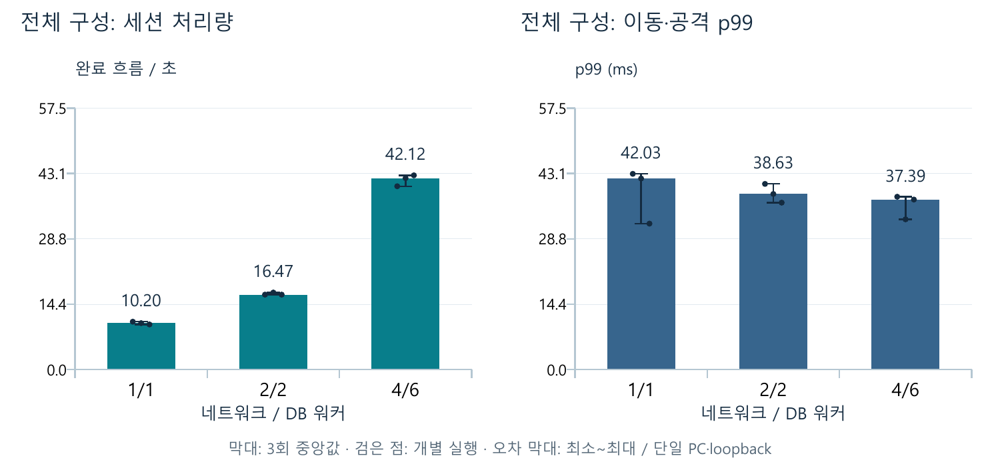
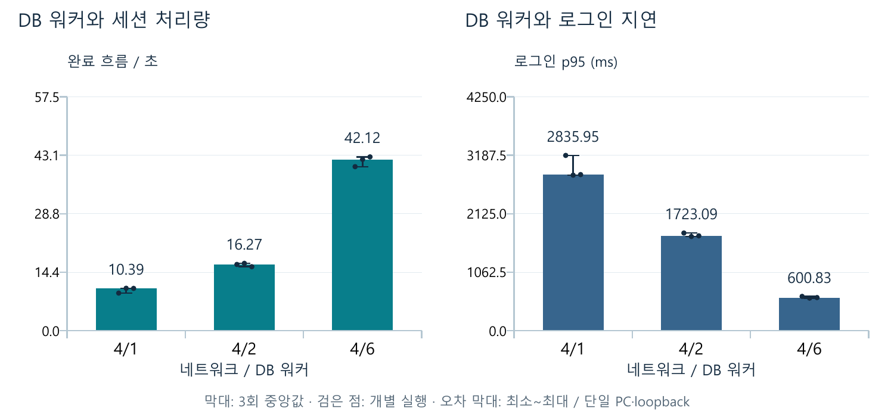
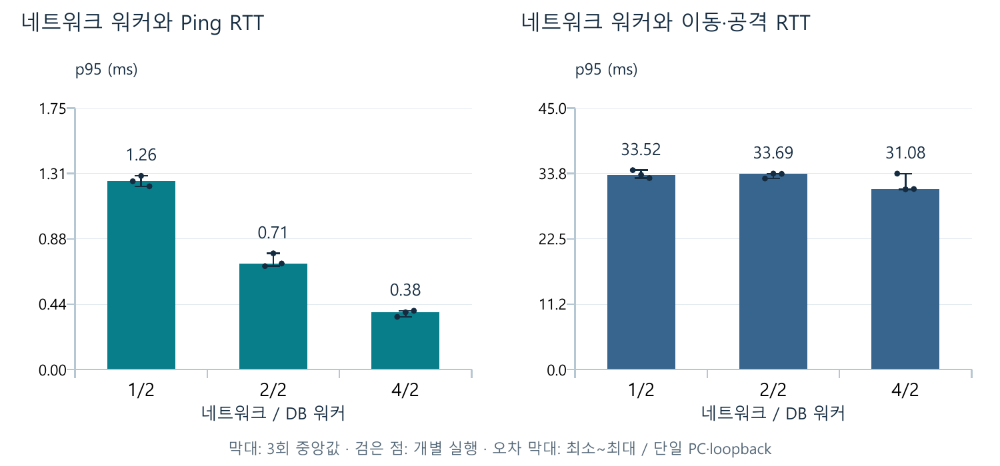

# 워커 비교 최종 검증 — 2026-10-19

6개 설정×3회 = 18회 완료. 세션 1,728건, Ping/이동·공격 응답 3,907,163개, 더미 오류 0.
Redis/XML/MSSQL 3,672명 점수 일치, 리플레이 18개 검증 완료. 공격 거부 303,539건은 통신 오류와 구분한다.

## 조건과 측정 경계

- Ryzen 7 7700X, 8코어/16논리 CPU, RAM 약 64GB, Windows 11 Pro. 서버·더미·MSSQL·Redis 모두 같은 PC, loopback. x64 Release.
- Game A/B/C·World 4프로세스에 동일한 네트워크/DB 워커 설정. Grid·20Hz·기록 5Hz·Redis 갱신 1초·Metrics 1초 고정.
- 공통 게임 서버 실행 파일은 1,500명 시연과도 해시가 같다. 더미에 워밍업/원본 표본/fixed-combat/SessionLoad 계측을 추가했다. 이 시험으로 제품 게임 로직은 수정하지 않았다.
- 설정별 같은 Unit/Skill/Map/StartPoint 사본. 종족별 Marine/Zealot/Hydralisk 1종, HP=100000·속도=100·사거리=8·스킬 없음. 원본 데이터와 Server.ini는 덮어쓰지 않았다.
- 세션: 기존 계정 96개, 동시 작업 32개. Game A 로그인→World 이동→로그아웃. 계정 생성 및 별도 12명 경로 예열은 제외. 각 계정 한 번 측정.
- LoginMs: Hello 이후 JoinGame 요청 왕복. TransferMs: 이동 티켓 요청부터 World 접속/Hello/입장까지. TotalMs/완료 처리량: 전체 연결과 로그인·이동·로그아웃 흐름. LoginMs는 전체 흐름 시간이 아니다.
- Ping: 96연결×연결당 목표 상한 100회/초. 이동·고정 상대 공격: 96명×목표 상한 20회/초. 각각 워밍업 3초 후 20초. 응답을 기다리는 closed-loop라 실제 전송률이 상한보다 낮을 수 있다.
- fixed-combat은 이동/지정 상대 공격을 교대로 보낸다. 허용/거부 응답을 모두 RTT에 포함한다. 이동은 전부 허용됐다. 공격 거부 이유별 건수는 계측하지 않았다.
- 회차 내 설정 순서는 사전에 섞었으며 2회차는 Ping/전투 순서도 교대했다. seed=20261019. 실행 중 다른 시험·빌드를 겹치지 않았다. OS/일반 앱/SQL 캐시를 완전히 통제하지는 않았다.
- 표는 실행별 원본 표본의 nearest-rank 분위수를 계산한 뒤 세 실행의 **중앙값 (최소~최대)**. 전체 표본의 p95나 반복 p95의 평균이 아니다.

## 전체 구성 비교

| N/DB | 세션 완료/초 | 로그인 p95 ms | 이동·공격 p99 ms |
| --- | ---: | ---: | ---: |
| 1/1 | 10.20 (9.91~10.52) | 2,845.54 (2,799.91~2,959.03) | 42.03 (32.10~43.05) |
| 2/2 | 16.47 (16.47~16.93) | 1,748.22 (1,680.65~1,750.81) | 38.63 (36.71~40.84) |
| 4/6 | 42.12 (40.32~42.73) | 600.83 (591.30~622.03) | 37.39 (33.04~38.01) |



## 네트워크=4 고정, DB 워커 비교

| N/DB | 세션 완료/초 | 로그인 p95 ms | 이동 p95 ms |
| --- | ---: | ---: | ---: |
| 4/1 | 10.39 (9.23~10.42) | 2,835.95 (2,825.64~3,184.51) | 2,810.17 (2,763.85~3,159.82) |
| 4/2 | 16.27 (15.71~16.55) | 1,723.09 (1,711.05~1,774.09) | 1,675.10 (1,647.54~1,725.67) |
| 4/6 | 42.12 (40.32~42.73) | 600.83 (591.30~622.03) | 531.94 (530.22~547.87) |

DB 1→6의 세션 완료 처리량 중앙값은 **4.06배**다. 이 워커는 PBKDF2-SHA256 600,000회와 ODBC를 함께 수행하므로 SQL 엔진 단독 개선율이 아니다.



## DB=2 고정, 네트워크 워커 비교

| N/DB | Ping 응답/초 | Ping p95 ms | 이동·공격 p95 ms |
| --- | ---: | ---: | ---: |
| 1/2 | 8,912.96 (8,893.92~8,917.61) | 1.261 (1.227~1.297) | 33.52 (32.96~34.33) |
| 2/2 | 8,921.35 (8,903.27~8,958.16) | 0.710 (0.692~0.777) | 33.69 (32.89~33.73) |
| 4/2 | 8,916.63 (8,883.48~8,956.88) | 0.383 (0.352~0.393) | 31.08 (31.04~33.73) |

Ping 지연은 줄었지만 전투 응답은 동일한 배수로 줄지 않았고 반복 범위도 겹친다. 전투 상태는 메인 한 스레드가 소유한다. 병목 위치별 대기 시간을 측정하지 않아 CPU 포화나 특정 큐 병목으로 단정하지 않는다.



## CPU와 틱

CPU 100%는 논리 CPU 한 개, PC 전체 기준은 16으로 나눈다. CPU는 각 단계 3회 중앙값, 틱은 단계 안의 1초 지표에서 관측한 최댓값이다. 각 CPU 열은 다른 단계이므로 합산하지 않는다.

| N/DB | 세션 A CPU % | 전투 World CPU % | 전투 더미 CPU % | 전투 Tick 최대 ms |
| --- | ---: | ---: | ---: | ---: |
| 1/1 | 93.6 | 8.1 | 28.1 | 6.350 |
| 2/2 | 182.2 | 9.3 | 28.3 | 6.228 |
| 4/6 | 475.8 | 9.1 | 26.4 | 6.744 |
| 1/2 | 180.1 | 7.8 | 22.5 | 5.952 |
| 4/2 | 179.2 | 9.5 | 24.4 | 6.640 |
| 4/1 | 94.9 | 8.4 | 20.1 | 6.237 |

전투 측정 내부 지표의 생략 틱은 모두 0. 이는 앞선 1,500명 시연의 틱 예산 초과를 해소했다는 뜻이 아니다. 이번 부하는 96명·고정 유닛이다.
CPU 경계는 로그 마커 관측 약 50ms 오차, 메모리는 주기 표본 최대다. 큐와 틱은 단계 내부 1초 구간만 사용하며 전체 실행 절대 최대가 아니다. SQL/Redis 프로세스 CPU는 제외했다.

## 검증과 보관

- Debug/Release 빌드·로컬 DB 연결, 기존 test-load -Quick 회귀 통과.
- 18회 정상 종료, 96명 유지(사망 0), 원본 표본 수/순서/ID/허용/워밍업 경계 검증.
- 각 경기 예열 12+세션 96+전투 96=204명, 총 3,672명의 Redis 세 점수·Hash ID 집합과 XML, SQL 결과 일치.
- 모두 시간 제한 후 server_shutdown으로 종료, 승리 판정 경기가 아니다. SQL Complete=false, 리플레이 complete=1은 파일이 정상 마감됐다는 뜻이다.
- 원본 CSV는 gzip 무손실 압축 후 해제 바이트를 대조했다. 원본·압축 SHA256은 raw-sample-manifest.json에 있다. analyze.py는 .csv/.csv.gz 모두 읽는다.
- matrix/plan.json: 실제 순서/조건/소스와 exe 해시. runner-used.py: 당시 실행한 원본 실행기. run_benchmark.py는 이후 출력 경로 옵션/예비 시험 메타데이터를 보완했다.
- comparison.csv, trials.csv, resources-summary.csv, summary.json: 표·그래프 근거. matrix/r*/: 원본 로그·표본·설정·XML·리플레이 검사.
- sql-validation.csv, redis-replay-validation.json: 전원 정합성. 이전 1,500명 증거는 ../redis-final/에 별도로 보관.
- test-workers.ps1 -Pilot 재실행 경로 확인 완료. full 실행은 18회 후 SQL/Redis/리플레이/표본 검증과 그래프 생성을 수행한다. Redis 정합성 재검사는 보관 TTL 이전에 해야 한다.

## 재실행

```powershell
.\build.ps1 -Configuration Release -RunDbCheck
.\test-workers.ps1 -Pilot
.\test-workers.ps1
```

다른 서버·더미를 종료하고 실행한다. 새 실행 폴더·결과 폴더·격리 Realm을 만들며 기존 결과를 덮어쓰지 않는다. Python/ReportLab/Poppler가 필요하고 기본 경로는 설치된 Codex 런타임이다.

## 해석 한계

1/1도 다른 스레드가 있는 구성이다. Grid는 검색 방식이며 전장 병렬화가 아니다. 96명 비교와 1,500명 시연을 동일 부하의 전후 개선으로 묶지 않는다. 로그인/전투 동시 폭주·장시간·독립 부하 PC·open-loop 최대 처리량·전장 병렬화는 검증하지 않았다. 3회 범위는 신뢰구간이 아니며 최적 워커 수나 실서비스 수용량을 보장하지 않는다.
